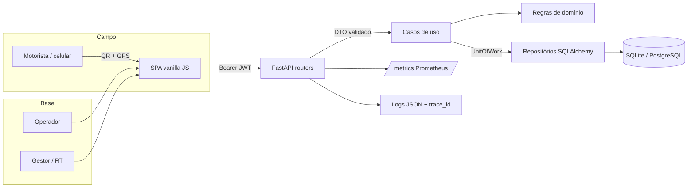
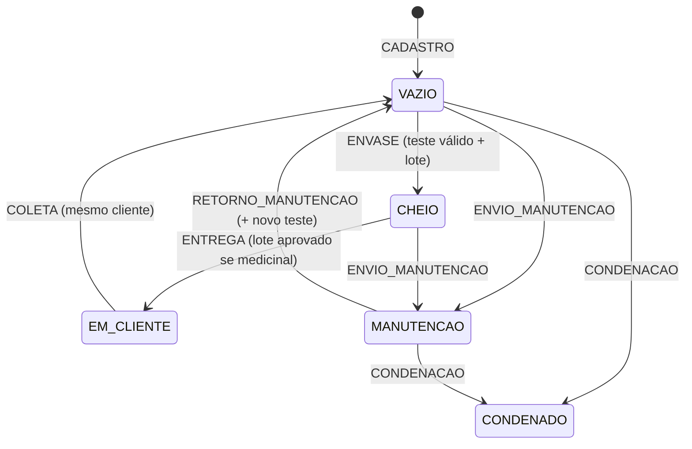

# GasControl — Gestão e rastreabilidade de cilindros de gases industriais e medicinais

Sistema próprio que cobre o núcleo funcional de soluções como Oryx Place, SAG, RTSys e OndeVou Gases:

| Recurso | Implementação |
|---|---|
| Rastreio individual por QR Code | Cada cilindro gera QR `GC1:<serial>`. Leitura pela câmera (BarcodeDetector) ou leitor USB/Bluetooth |
| Saldo de cheios/vazios/em cliente | Máquina de estados + painel com saldo por cliente e por gás |
| Comodato | Flag por entrega; saldo de comodato por cliente |
| Entrega, coleta e **troca** | Troca = entrega + coleta na mesma transação atômica (`operation_id` comum) |
| Teste hidrostático | Validade configurável (padrão 5 anos). Envase bloqueado se vencido. Alerta antecipado (padrão 60 dias) |
| Lotes de envase (RDC ANVISA) | Lote nasce em QUARENTENA. GESTOR (responsável técnico) aprova/reprova. Medicinal exige laudo |
| Bloqueios regulatórios | Medicinal: envase exige lote; entrega exige lote APROVADO e válido; gás do lote = gás do cilindro |
| Recall | `/api/lots/{id}/trace` lista todo cilindro e cliente que recebeu o lote |
| Trilha de auditoria | Movimentações append-only, encadeadas por SHA-256 por cilindro. `/api/audit/verify` detecta adulteração |
| App de campo | SPA responsiva (celular). Registra GPS e NF-e/romaneio na entrega |
| Perfis | ADMIN, GESTOR, OPERADOR, MOTORISTA |

## Arquitetura

Camadas (dependências apontam para dentro):

- `domain/` — regras puras: máquina de estados, permissões por perfil, validade hidrostática, liberação de lote, CPF/CNPJ, hash da trilha. Sem I/O.
- `application/` — casos de uso (`services.py`), portas (`ports.py`, Protocols de repositório + Unit of Work), segurança (scrypt, JWT, throttle).
- `infra/` — SQLAlchemy: ORM, repositórios e Unit of Work.
- `api/` — FastAPI: schemas Pydantic (validação de borda), dependências de auth, rotas.
- `main.py` — composition root: injeta dependências, middlewares, health/metrics, frontend.



Ciclo de vida do cilindro:



### Decisões e trade-offs

- **Monólito modular** em vez de microsserviços: o domínio é coeso (cilindro ↔ lote ↔ cliente) e transações atômicas (troca) ficam triviais.
- **Lock otimista** (`version_id_col`) no cilindro: dois motoristas bipando o mesmo cilindro → o segundo recebe 409.
- **Hash encadeado por cilindro** (não global): evita gargalo de escrita; a constraint `UNIQUE(cylinder_id, prev_hash)` impede bifurcação da cadeia.
- **Token no `sessionStorage` + header Bearer** (sem cookie): elimina CSRF. O risco migra para XSS, mitigado por CSP `script-src 'self'` e por renderização exclusiva via `textContent`.
- **SQLite por padrão** (WAL): suficiente para uma revenda com uma instância. Para múltiplas réplicas use PostgreSQL e troque o throttle de login em memória por Redis.
- Repositórios retornam entidades ORM (não modelos de domínio separados): reduz mapeamento duplicado; as regras ficam isoladas em `domain/rules.py`.

## Estrutura

```
gascontrol/
├── app/
│   ├── config.py              # Settings via env
│   ├── observability.py       # logs JSON, trace_id, métricas
│   ├── main.py                # composition root
│   ├── domain/{rules,errors}.py
│   ├── application/{services,ports,security}.py
│   ├── infra/{db,orm,repositories}.py
│   ├── api/{schemas,deps}.py
│   ├── api/routers/{auth,catalog,cylinders}.py
│   └── static/{index.html,app.js,styles.css}
├── tests/                     # domínio + API (22 testes)
├── Dockerfile  docker-compose.yml  .env.example
└── requirements*.txt
```

## Operação

### Local

```bash
cd gascontrol
python -m venv .venv && . .venv/bin/activate
pip install -r requirements-dev.txt
pytest
export ADMIN_EMAIL=admin@empresa.com.br ADMIN_PASSWORD='Troque-Esta-Senha-1!'
uvicorn app.main:create_app --factory --reload
# http://localhost:8000  (Swagger em /docs fora de produção)
```

### Docker

```bash
cp .env.example .env   # preencha JWT_SECRET e ADMIN_PASSWORD
docker compose up -d --build
curl localhost:8000/ready
```

Coloque um proxy reverso com TLS (Caddy/Nginx) na frente. A câmera do celular só funciona em HTTPS.

### Fluxo típico

1. GESTOR cadastra clientes (CPF/CNPJ validado) e usuários.
2. OPERADOR cadastra cilindros → imprime a etiqueta QR.
3. OPERADOR cria o lote (quarentena) → GESTOR aprova com o laudo.
4. OPERADOR registra ENVASE (bipa o cilindro, escolhe o lote).
5. MOTORISTA registra ENTREGA / COLETA / TROCA no celular.
6. Painel mostra saldo por cliente, comodatos, alertas hidrostáticos e lotes pendentes.

### Endpoints de operação

| Endpoint | Uso |
|---|---|
| `GET /health` | liveness |
| `GET /ready` | readiness (testa o banco) |
| `GET /metrics` | Prometheus (protegido por `METRICS_TOKEN` se definido) |
| `GET /api/audit/verify` | integridade da trilha (GESTOR) |

Métricas: `gascontrol_http_requests_total`, `gascontrol_http_request_duration_seconds`, `gascontrol_movements_total{type}`, `gascontrol_domain_rejections_total{code}`, `gascontrol_login_failures_total`.

## Análise de segurança

| Vetor | Mitigação |
|---|---|
| Injeção SQL | Só ORM/Core parametrizado. `LIKE` com escape de `%`/`_` |
| XSS | Frontend nunca usa `innerHTML`; CSP `default-src 'self'` sem inline |
| CSRF | Auth por header Bearer; sem cookies de sessão |
| IDOR / escalonamento | Perfil revalidado no banco a cada requisição; permissão por tipo de movimentação no domínio; MOTORISTA só lista as próprias movimentações; coleta exige que o cilindro esteja no cliente informado |
| Força bruta | scrypt (N=2^15), bloqueio por e-mail+IP, tempo constante para e-mail inexistente |
| Adulteração de registros | Cadeia SHA-256 por cilindro + verificação sob demanda |
| QR malicioso | Payload opaco `GC1:<serial>` validado por regex; nunca é URL |
| Mass assignment | Schemas `extra="forbid"`; update de cliente com whitelist de campos |
| Segredos | Só via env; boot falha em produção sem `JWT_SECRET` ≥ 32 chars |
| Container | Usuário non-root, FS read-only, `cap_drop: ALL`, `no-new-privileges` |

### Limites conhecidos

- Não emite NF-e (só guarda a referência). Integração com SEFAZ/ERP fiscal é o próximo passo natural.
- Não funciona offline. Um app de campo com fila offline (PWA + IndexedDB) seria a evolução para áreas sem sinal.
- A conformidade com a RDC ANVISA depende também de processo e documentação da empresa. O software dá rastreabilidade e bloqueios, não substitui o responsável técnico.
