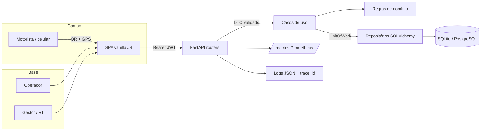
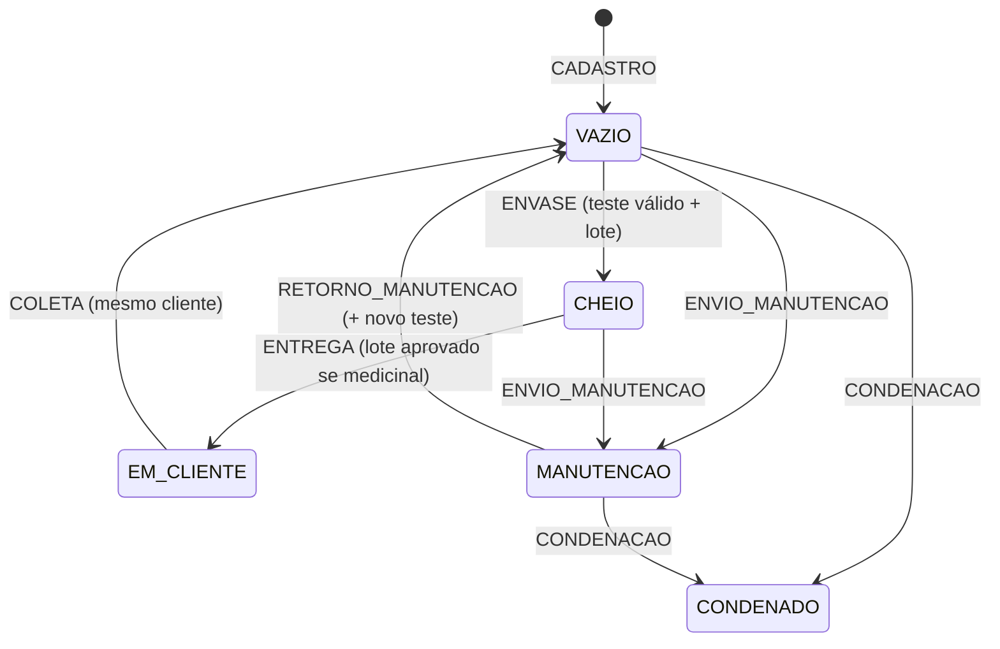

# GasControl — Gestão e rastreabilidade de cilindros de gases industriais e medicinais

Sistema próprio que cobre o núcleo funcional de soluções como Oryx Place, SAG, RTSys e OndeVou Gases:

| Recurso | Implementação |
|---|---|
| Rastreio individual por QR Code | Cada cilindro gera QR `GC1:<serial>`. Leitura pela câmera (BarcodeDetector) ou leitor USB/Bluetooth |
| Saldo de cheios/vazios/em cliente | Máquina de estados + painel com saldo por cliente e por gás |
| Comodato | Flag por entrega; saldo de comodato por cliente |
| Entrega, coleta e **troca** | Troca = entrega + coleta na mesma transação atômica (`operation_id` comum) |
| Teste hidrostático | Validade configurável (padrão 5 anos). Envase bloqueado se vencido. Alerta antecipado (padrão 60 dias) |
| Lotes de envase (RDC ANVISA) | Lote nasce em QUARENTENA. GESTOR (responsável técnico) aprova/reprova. Medicinal exige laudo |
| Bloqueios regulatórios | Medicinal: envase exige lote; entrega exige lote APROVADO e válido; gás do lote = gás do cilindro |
| Recall | `/api/lots/{id}/trace` lista todo cilindro e cliente que recebeu o lote |
| Trilha de auditoria | Movimentações append-only, encadeadas por SHA-256 por cilindro. `/api/audit/verify` detecta adulteração |
| App de campo **offline** | Instalável no celular (PWA). Funciona sem internet e sincroniza sozinho ao reconectar. Registra GPS e NF-e/romaneio |
| Assinatura eletrônica | Liberação de lote exige reconfirmar a senha. Grava o significado do ato e o hash |
| Checklist pré-envase | Obrigatório para gás medicinal (visual, válvula, rótulo, cor NBR 12176, purga) |
| Auditoria de cadastros | Toda criação/alteração de usuário, cliente, lote e cilindro, encadeada por hash |
| Dossiê para fiscalização | CSV do lote (recall) e do histórico do cilindro |
| HTTPS gratuito | Caddy com certificado Let's Encrypt automático |
| Backup automático | A cada 6 h, com verificação de integridade e rotação |
| Perfis | ADMIN, GESTOR, OPERADOR, MOTORISTA |

## Arquitetura

Camadas (dependências apontam para dentro):

- `domain/` — regras puras: máquina de estados, permissões por perfil, validade hidrostática, liberação de lote, CPF/CNPJ, hash da trilha. Sem I/O.
- `application/` — casos de uso (`services.py`), portas (`ports.py`, Protocols de repositório + Unit of Work), segurança (scrypt, JWT, throttle).
- `infra/` — SQLAlchemy: ORM, repositórios e Unit of Work.
- `api/` — FastAPI: schemas Pydantic (validação de borda), dependências de auth, rotas.
- `main.py` — composition root: injeta dependências, middlewares, health/metrics, frontend.



Ciclo de vida do cilindro:



### Decisões e trade-offs

- **Monólito modular** em vez de microsserviços: o domínio é coeso (cilindro ↔ lote ↔ cliente) e transações atômicas (troca) ficam triviais.
- **Lock otimista** (`version_id_col`) no cilindro: dois motoristas bipando o mesmo cilindro → o segundo recebe 409.
- **Hash encadeado por cilindro** (não global): evita gargalo de escrita; a constraint `UNIQUE(cylinder_id, prev_hash)` impede bifurcação da cadeia.
- **Token no `sessionStorage` + header Bearer** (sem cookie): elimina CSRF. O risco migra para XSS, mitigado por CSP `script-src 'self'` e por renderização exclusiva via `textContent`.
- **SQLite por padrão** (WAL): suficiente para uma revenda com uma instância. Para múltiplas réplicas use PostgreSQL e troque o throttle de login em memória por Redis.
- Repositórios retornam entidades ORM (não modelos de domínio separados): reduz mapeamento duplicado; as regras ficam isoladas em `domain/rules.py`.

## Modo offline (app de campo)

```mermaid
sequenceDiagram
  participant M as Motorista (celular)
  participant IDB as IndexedDB (aparelho)
  participant API as Servidor
  M->>IDB: registra operação (grava ANTES de enviar)
  Note over M,IDB: sem internet: pré-validação local com o snapshot
  M-->>API: ao reconectar: POST /api/sync/batch (até 50 itens)
  API->>API: ordena pela hora do campo, aplica cada item na própria transação
  API->>API: recibo por client_uuid (reenvio nunca duplica)
  API-->>M: ok / duplicate / rejected (motivo)
  M->>IDB: remove enviados; recusados vão para "Pendências"
  M->>API: GET /api/sync/snapshot (atualiza cache)
```

Como funciona:

- **Service worker** guarda a interface. O app abre mesmo sem sinal.
- **Snapshot**: clientes, lotes e status de cada cilindro ficam no aparelho. O app usa esses dados para validar a operação localmente, por exemplo para impedir a entrega de um cilindro que já está no cliente.
- **Fila (outbox)**: cada operação recebe um UUID e é gravada no aparelho antes de qualquer envio. Se a rede cair no meio, nada se perde. Se a resposta se perder, o reenvio é reconhecido como duplicado.
- **Sincronização automática**: ao reconectar, a cada 30 s e ao reabrir o app. O botão "Sincronizar" força o envio.
- **O servidor sempre revalida**: se algo mudou enquanto o motorista estava offline (outro usuário mexeu no mesmo cilindro), a operação vai para "Recusadas", com o motivo. Ela não some e não é aplicada sem conferência. O usuário pode reenviar ou descartar.
- **Hora do campo × hora do servidor**: as duas ficam gravadas. A hora do campo é aceita até 10 min no futuro e 30 dias no passado.
- **Sessão offline**: após um login com internet, o app opera offline por até 72 h. Para enviar, o token precisa estar válido; se expirou, o app pede login e mantém a fila. Cada item da fila fica preso ao usuário que o criou: outra pessoa logada no mesmo aparelho não envia operações alheias.
- **Instalar no celular**: abra o endereço HTTPS no Chrome/Safari → "Adicionar à tela inicial".

Limite: a leitura de QR pela câmera usa a API nativa `BarcodeDetector` (Chrome/Android). No iPhone, use um leitor Bluetooth ou digite a série.

## Estrutura

```
gascontrol/
├── app/
│   ├── config.py              # Settings via env
│   ├── observability.py       # logs JSON, trace_id, métricas
│   ├── main.py                # composition root
│   ├── domain/{rules,errors}.py
│   ├── application/{services,ports,security}.py
│   ├── infra/{db,orm,repositories}.py
│   ├── api/{schemas,deps}.py
│   ├── api/routers/{auth,catalog,cylinders,sync,reports}.py
│   ├── tools/backup.py        # backup online do SQLite com rotação
│   └── static/                # SPA + sw.js + db.js (IndexedDB) + manifest
├── deploy/Caddyfile(.lan)     # proxy HTTPS
├── tests/                     # 32 testes: domínio, API, offline, conformidade
├── CONFORMIDADE.md            # matriz regulatória
├── Dockerfile  docker-compose.yml  .env.example
└── requirements*.txt
```

## Operação

### Local

```bash
cd gascontrol
python -m venv .venv && . .venv/bin/activate
pip install -r requirements-dev.txt
pytest
export ADMIN_EMAIL=admin@empresa.com.br ADMIN_PASSWORD='Troque-Esta-Senha-1!'
uvicorn app.main:create_app --factory --reload
# http://localhost:8000  (Swagger em /docs fora de produção)
```

### Produção com HTTPS gratuito (Caddy + Let's Encrypt)

Custo zero de software. Você só precisa de:

1. **Um servidor** com Docker e as portas 80 e 443 abertas: um PC da empresa ligado 24 h ou uma VPS.
2. **Um domínio** apontando para o IP desse servidor. Se não tiver um, o DuckDNS dá um subdomínio grátis (`suaempresa.duckdns.org`).

```bash
cp .env.example .env
# preencha: DOMAIN, ACME_EMAIL, JWT_SECRET, ADMIN_EMAIL, ADMIN_PASSWORD
docker compose up -d --build
# acesse https://SEU_DOMINIO  (o certificado é emitido e renovado sozinho)
```

O compose sobe 3 serviços: `caddy` (HTTPS, porta 443), `gascontrol` (sem porta exposta, só via Caddy) e `backup` (cópia a cada 6 h em `./backups`).

### Rede local sem domínio

Use `CADDYFILE=Caddyfile.lan` e `LAN_HOST=192.168.x.x` no `.env`. O Caddy gera um certificado próprio (`tls internal`). Cada celular precisa confiar nele uma vez:

```bash
docker compose cp caddy:/data/caddy/pki/authorities/local/root.crt ./gascontrol-ca.crt
```

Envie o `gascontrol-ca.crt` para o celular e instale-o: Android em Configurações → Segurança → Instalar certificado; iPhone em Ajustes → Perfil baixado, depois Ajustes → Geral → Sobre → Confiança de certificados.

### Restaurar backup

```bash
docker compose stop gascontrol
docker compose cp ./backups/gascontrol-AAAAMMDDTHHMMSSZ.db gascontrol:/data/gascontrol.db
docker compose start gascontrol
```

### Fluxo típico

1. GESTOR cadastra clientes (CPF/CNPJ validado) e usuários.
2. OPERADOR cadastra cilindros → imprime a etiqueta QR.
3. OPERADOR cria o lote (quarentena) → GESTOR aprova com o laudo.
4. OPERADOR registra ENVASE (bipa o cilindro, escolhe o lote).
5. MOTORISTA registra ENTREGA / COLETA / TROCA no celular.
6. Painel mostra saldo por cliente, comodatos, alertas hidrostáticos e lotes pendentes.

### Endpoints de operação

| Endpoint | Uso |
|---|---|
| `GET /health` | liveness |
| `GET /ready` | readiness (testa o banco) |
| `GET /metrics` | Prometheus (protegido por `METRICS_TOKEN` se definido) |
| `GET /api/audit/verify` | integridade da trilha (GESTOR) |

Métricas: `gascontrol_http_requests_total`, `gascontrol_http_request_duration_seconds`, `gascontrol_movements_total{type}`, `gascontrol_domain_rejections_total{code}`, `gascontrol_login_failures_total`.

## Análise de segurança

| Vetor | Mitigação |
|---|---|
| Injeção SQL | Só ORM/Core parametrizado. `LIKE` com escape de `%`/`_` |
| XSS | Frontend nunca usa `innerHTML`; CSP `default-src 'self'` sem inline |
| CSRF | Auth por header Bearer; sem cookies de sessão |
| IDOR / escalonamento | Perfil revalidado no banco a cada requisição; permissão por tipo de movimentação no domínio; MOTORISTA só lista as próprias movimentações; coleta exige que o cilindro esteja no cliente informado |
| Força bruta | scrypt (N=2^15), bloqueio por e-mail+IP, tempo constante para e-mail inexistente |
| Adulteração de registros | Cadeia SHA-256 por cilindro + verificação sob demanda |
| QR malicioso | Payload opaco `GC1:<serial>` validado por regex; nunca é URL |
| Mass assignment | Schemas `extra="forbid"`; update de cliente com whitelist de campos |
| Segredos | Só via env; boot falha em produção sem `JWT_SECRET` ≥ 32 chars |
| Container | Usuário non-root, FS read-only, `cap_drop: ALL`, `no-new-privileges` |

| Sincronização offline | Itens presos ao usuário que os criou; idempotência por UUID; servidor revalida tudo; hora do campo limitada |
| Assinatura eletrônica | Reautenticação + bloqueio após tentativas erradas |
| Injeção em planilha (CSV) | Células iniciadas por `= + - @` são neutralizadas |
| Exposição do app | Só o Caddy publica portas; `/metrics` bloqueado na internet |

### Limites conhecidos

- Não emite NF-e (só guarda a referência). A integração com SEFAZ/ERP fiscal seria o próximo passo.
- Reclamações/desvios (CAPA) ainda não estão no sistema.
- Ver `CONFORMIDADE.md` para o que depende de processo da empresa.
