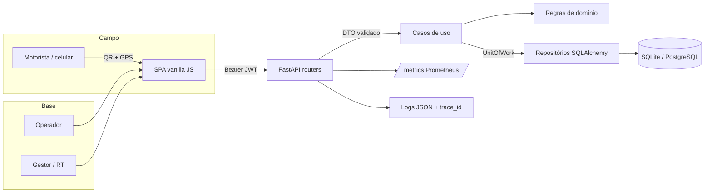
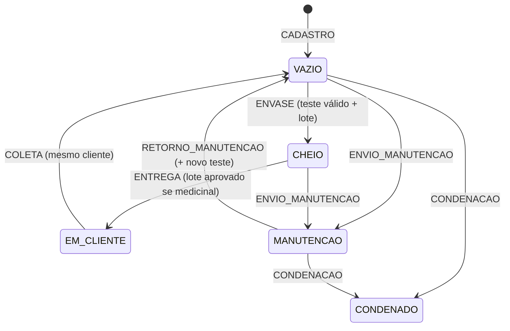
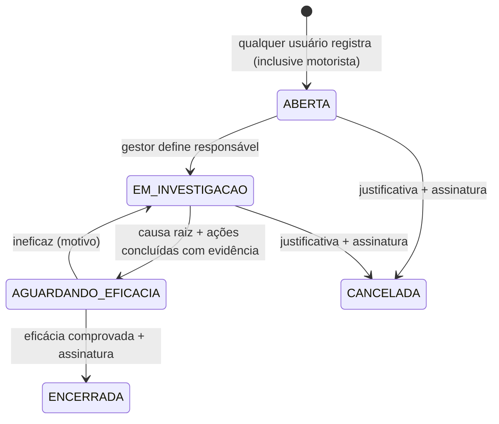

# PB Tecnologia - PB Gas Control — Gestão e rastreabilidade de cilindros de gases industriais e medicinais

Sistema próprio que cobre o núcleo funcional de soluções como Oryx Place, SAG, RTSys e OndeVou Gases:

| Recurso | Implementação |
|---|---|
| Rastreio individual por QR Code | Cada cilindro gera QR `GC1:<serial>`. Leitura pela câmera (BarcodeDetector) ou leitor USB/Bluetooth |
| Saldo de cheios/vazios/em cliente | Máquina de estados + painel com saldo por cliente e por gás |
| Comodato | Flag por entrega; saldo de comodato por cliente |
| Entrega, coleta e **troca** | Troca = entrega + coleta na mesma transação atômica (`operation_id` comum) |
| Teste hidrostático | Validade configurável (padrão 5 anos). Envase bloqueado se vencido. Alerta antecipado (padrão 60 dias) |
| Lotes de envase (RDC ANVISA) | Lote nasce em QUARENTENA. GESTOR (responsável técnico) aprova/reprova. Medicinal exige laudo |
| Bloqueios regulatórios | Medicinal: envase exige lote; entrega exige lote APROVADO e válido; gás do lote = gás do cilindro |
| Recall | `/api/lots/{id}/trace` lista todo cilindro e cliente que recebeu o lote |
| Trilha de auditoria | Movimentações append-only, encadeadas por SHA-256 por cilindro. `/api/audit/verify` detecta adulteração |
| App de campo **offline** | App Android (APK) ou PWA no navegador. Funciona sem internet e sincroniza sozinho ao reconectar. Registra GPS e NF-e/romaneio |
| Assinatura eletrônica | Liberação de lote exige reconfirmar a senha. Grava o significado do ato e o hash |
| Checklist pré-envase | Obrigatório para gás medicinal (visual, válvula, rótulo, cor NBR 12176, purga) |
| Auditoria de cadastros | Toda criação/alteração de usuário, cliente, lote e cilindro, encadeada por hash |
| Dossiê para fiscalização | CSV do lote (recall) e do histórico do cilindro |
| HTTPS gratuito | Caddy com certificado Let's Encrypt automático |
| Backup automático | A cada 6 h, com verificação de integridade e rotação |
| **Qualidade / CAPA** | Reclamações, desvios, não conformidades e eventos adversos com prazo por gravidade, causa raiz, ações corretivas/preventivas com evidência, verificação de eficácia e encerramento assinado |
| **Recall com bloqueio** | O gestor bloqueia o lote a partir da ocorrência: envase e entrega param na hora. O lote só volta pela quarentena, com nova liberação assinada |
| **NF-e** | Perfis fiscais por gás, "Faturar" direto da entrega/troca, emissão via Focus NFe, consulta automática da SEFAZ, DANFE/XML e cancelamento assinado |
| Perfis | ADMIN, GESTOR, OPERADOR, MOTORISTA |

## Arquitetura

Camadas (dependências apontam para dentro):

- `domain/` — regras puras: máquina de estados, permissões por perfil, validade hidrostática, liberação de lote, CPF/CNPJ, hash da trilha. Sem I/O.
- `application/` — casos de uso (`services.py`), portas (`ports.py`, Protocols de repositório + Unit of Work), segurança (scrypt, JWT, throttle).
- `infra/` — SQLAlchemy: ORM, repositórios e Unit of Work.
- `api/` — FastAPI: schemas Pydantic (validação de borda), dependências de auth, rotas.
- `main.py` — composition root: injeta dependências, middlewares, health/metrics, frontend.



Ciclo de vida do cilindro:



### Decisões e trade-offs

- **Monólito modular** em vez de microsserviços: o domínio é coeso (cilindro ↔ lote ↔ cliente) e transações atômicas (troca) ficam triviais.
- **Lock otimista** (`version_id_col`) no cilindro: dois motoristas bipando o mesmo cilindro → o segundo recebe 409.
- **Hash encadeado por cilindro** (não global): evita gargalo de escrita; a constraint `UNIQUE(cylinder_id, prev_hash)` impede bifurcação da cadeia.
- **Token no `sessionStorage` + header Bearer** (sem cookie): elimina CSRF. O risco migra para XSS, mitigado por CSP `script-src 'self'` e por renderização exclusiva via `textContent`.
- **SQLite por padrão** (WAL): suficiente para uma revenda com uma instância. Para múltiplas réplicas use PostgreSQL e troque o throttle de login em memória por Redis.
- Repositórios retornam entidades ORM (não modelos de domínio separados): reduz mapeamento duplicado; as regras ficam isoladas em `domain/rules.py`.

## Modo offline (app de campo)

```mermaid
sequenceDiagram
  participant M as Motorista (celular)
  participant IDB as IndexedDB (aparelho)
  participant API as Servidor
  M->>IDB: registra operação (grava ANTES de enviar)
  Note over M,IDB: sem internet: pré-validação local com o snapshot
  M-->>API: ao reconectar: POST /api/sync/batch (até 50 itens)
  API->>API: ordena pela hora do campo, aplica cada item na própria transação
  API->>API: recibo por client_uuid (reenvio nunca duplica)
  API-->>M: ok / duplicate / rejected (motivo)
  M->>IDB: remove enviados; recusados vão para "Pendências"
  M->>API: GET /api/sync/snapshot (atualiza cache)
```

Como funciona:

- **Service worker** guarda a interface. O app abre mesmo sem sinal.
- **Snapshot**: clientes, lotes e status de cada cilindro ficam no aparelho. O app usa esses dados para validar a operação localmente, por exemplo para impedir a entrega de um cilindro que já está no cliente.
- **Fila (outbox)**: cada operação recebe um UUID e é gravada no aparelho antes de qualquer envio. Se a rede cair no meio, nada se perde. Se a resposta se perder, o reenvio é reconhecido como duplicado.
- **Sincronização automática**: ao reconectar, a cada 30 s e ao reabrir o app. O botão "Sincronizar" força o envio.
- **O servidor sempre revalida**: se algo mudou enquanto o motorista estava offline (outro usuário mexeu no mesmo cilindro), a operação vai para "Recusadas", com o motivo. Ela não some e não é aplicada sem conferência. O usuário pode reenviar ou descartar.
- **Hora do campo × hora do servidor**: as duas ficam gravadas. A hora do campo é aceita até 10 min no futuro e 30 dias no passado.
- **Sessão offline**: após um login com internet, o app opera offline por até 72 h. Para enviar, o token precisa estar válido; se expirou, o app pede login e mantém a fila. Cada item da fila fica preso ao usuário que o criou: outra pessoa logada no mesmo aparelho não envia operações alheias.
- **Instalar no celular**: abra o endereço HTTPS no Chrome/Safari → "Adicionar à tela inicial".

Limite: a leitura de QR pela câmera usa a API nativa `BarcodeDetector` (Chrome/Android). No iPhone, use um leitor Bluetooth ou digite a série.

## Qualidade (CAPA)



- **Prazos de investigação**: crítica 2 dias, alta 7, média 15, baixa 30. Atrasos aparecem no painel.
- **Evento adverso** é sempre classificado no mínimo como ALTA. Não conformidade e evento adverso exigem lote ou cilindro. O lote é herdado do cilindro.
- **Recall**: "Bloquear lote" (assinado) muda o lote para BLOQUEADO, e nenhum envase ou entrega desse lote passa. Para encerrar a ocorrência, o lote precisa voltar à QUARENTENA, e aí o responsável técnico decide de novo: aprova ou reprova, com assinatura.
- O motorista vê apenas as ocorrências que ele mesmo abriu.

## NF-e

1. **Perfis fiscais** (Fiscal → Configurar): NCM, CFOP interno/interestadual, CST/CSOSN, alíquota, PIS/COFINS e preço padrão por gás. **Quem define é o contador.**
2. **Endereço fiscal do cliente** (Clientes → Endereço fiscal): logradouro, número, bairro, município, UF, CEP e IE.
3. **Faturar**: em Movimentações, o botão "Faturar" de uma entrega gera o rascunho (um item por gás, quantidade = nº de cilindros, preço padrão). Edite e clique em "Emitir NF-e".
4. O sistema escolhe o CFOP sozinho (interno ou interestadual, pela UF do cliente). A nota fica em PROCESSANDO e a consulta automática traz a autorização, a chave, o número e os links do DANFE e do XML.
5. **Cancelamento**: com assinatura e justificativa de 15 a 255 caracteres, dentro do prazo (`FISCAL_CANCEL_HOURS`, padrão 24 h).

Robustez:
- A nota é gravada como PROCESSANDO **antes** do envio.
- Se a resposta se perder, a consulta pela referência resolve. O envio nunca é repetido às cegas, então não há risco de nota em duplicidade.
- Se o emissor recusar a nota, a correção vai com uma nova referência.
- Timeout de 20 s, até 3 novas tentativas nas consultas, e circuit breaker após 5 falhas.
- Links de DANFE/XML só são aceitos do domínio do próprio emissor.

**Antes de produção**:
- Contrate o Focus NFe (serviço pago, cobrado por nota) e cadastre o certificado A1 da empresa no painel deles.
- Rode em `FOCUS_ENVIRONMENT=homologacao` e emita notas de teste com o contador.
- O mapeamento de campos está todo em `app/infra/fiscal_gateway.py`. Confira com a documentação oficial (doc.focusnfe.com.br), principalmente os campos da Reforma Tributária (IBS/CBS).

Limite: a remessa de **cilindro em comodato** (CFOP 5908/6908, NCM do recipiente) ainda não tem perfil próprio. Por ora, emita essa nota no sistema do contador.

## Instaladores (Windows e Android)

> Segurança e privacidade: veja [SEGURANCA.md](SEGURANCA.md) (pentest) e [LGPD.md](LGPD.md).

Os dois instaladores são gerados automaticamente pelo GitHub Actions (`.github/workflows/installers.yml`)
a cada push que altera `gascontrol/`. Baixe em **Actions → execução → Artifacts**. Ao criar uma tag
`v1.4.0`, eles também são publicados em uma **Release**.

| Arquivo | Para quê |
|---|---|
| `PBGasControl-Setup-<versão>.exe` | Servidor + sistema completo num PC Windows 10/11 (64 bits) da empresa |
| `PBGasControl-<versão>.apk` | App de campo para Android 8+ (motoristas/operadores) |

### Windows (servidor)

1. Execute `PBGasControl-Setup-x.y.z.exe` como administrador.
2. Informe o e-mail do administrador e a porta (padrão 8000). Marque "Liberar acesso pela rede local" para os celulares acessarem.
3. Ao final, o instalador mostra `PRIMEIRO-ACESSO.txt` com a **senha inicial gerada** e os endereços de rede (ex.: `http://192.168.0.10:8000`).
4. Entre e troque a senha em **Minha senha**. Apague o `PRIMEIRO-ACESSO.txt`.

Instalação automatizada (TI): `PBGasControl-Setup-x.y.z.exe /VERYSILENT /ADMINEMAIL=ti@empresa.com.br /PORT=8000 /TASKS=firewall`.

O que o instalador faz:
- O servidor roda como tarefa do Windows na conta SYSTEM, inicia junto com o computador (mesmo sem ninguém logado) e reinicia sozinho se cair.
- Dados, configuração e logs ficam em `C:\ProgramData\PB Gas Control\` (acesso restrito a Administradores):
  - `pbgas.db`: banco de dados.
  - `config.env`: configuração (JWT_SECRET gerado na instalação; NF-e: `FISCAL_PROVIDER`, `FOCUS_TOKEN` etc.).
  - `logs\pbgas.log`: logs JSON com rotação.
  - `backups\`: cópia diária verificada, guardando as últimas 30.
- Atualizar: execute o novo instalador por cima. Dados e configuração são preservados.
- Desinstalar remove o programa, a tarefa e a regra de firewall. **Os dados são mantidos**.
- Firewall: a regra vale só para redes Domínio/Privada. Se o Windows marcou a rede como "Pública", mude para "Privada".
- Depois de editar `config.env`, reinicie o servidor: Agendador de Tarefas → "PB Gas Control" → Finalizar/Executar, ou reinicie o PC.

> Servidor na internet (fora da rede local): use o modo Docker + Caddy com HTTPS (seção "Operação").
> O servidor Windows atende a rede local por HTTP.

### Android (app de campo)

1. Copie o `.apk` para o celular e instale. Na primeira vez, autorize "instalar apps desta fonte".
2. Na tela de login, preencha **Servidor**:
   - Rede local: `192.168.0.10:8000` (endereço do `PRIMEIRO-ACESSO.txt`).
   - Internet: `https://gases.suaempresa.com.br`.
3. Entre com usuário e senha.

Como funciona:
- A interface vem **dentro do app**: abre e registra operações sem internet desde o primeiro uso após o login.
  A fila offline sincroniza sozinha ao reconectar, igual à versão web.
- **Leitor de QR nativo** (câmera traseira): QR `GC1:`, Code 128, Code 39, EAN-13 e Data Matrix.
- **Exportações CSV** vão para `Downloads/PB Gas Control` e abrem o menu de compartilhar (WhatsApp, e-mail, Drive).
- DANFE/XML abrem no navegador do celular.
- Segurança:
  - `http://` só é aceito para endereços de rede local; servidor público exige `https://`.
  - Trocar de servidor só é permitido sem operações pendentes.
  - Os dados do app ficam fora do backup em nuvem do Android.

**Assinatura do APK (obrigatória para distribuir atualizações).** Sem chave configurada, o CI gera um
APK de **teste** (`-teste.apk`, assinatura de depuração). Cada build de teste pode exigir desinstalar antes
de instalar o próximo. Para gerar o APK oficial, crie a chave **uma vez** e guarde-a em local seguro:

```bash
keytool -genkeypair -v -keystore pbgas.jks -alias pbgas -keyalg RSA -keysize 4096 -validity 10000
base64 -w0 pbgas.jks   # conteúdo do segredo PBGAS_KEYSTORE_BASE64
```

Cadastre em **GitHub → Settings → Secrets and variables → Actions** os segredos:
`PBGAS_KEYSTORE_BASE64`, `PBGAS_KEYSTORE_PASSWORD`, `PBGAS_KEY_ALIAS` (`pbgas`) e `PBGAS_KEY_PASSWORD`.
Perder essa chave impede atualizar o app nos aparelhos: será preciso desinstalar e reinstalar.

### Compilar localmente

```powershell
# Windows (na pasta gascontrol): requer Python 3.13 e Inno Setup 6
pip install -r requirements.txt pyinstaller==6.22.3
python packaging/windows/make_version_info.py
pyinstaller --noconfirm packaging/windows/pbgas-server.spec
& "${env:ProgramFiles(x86)}\Inno Setup 6\ISCC.exe" /DAppVersion=1.4.0 packaging\windows\installer.iss
# saída: dist\installer\PBGasControl-Setup-1.4.0.exe
```

```bash
# Android (na pasta gascontrol/android): requer JDK 17, Android SDK 35 e Gradle 8.14
gradle assembleDebug      # app/build/outputs/apk/debug/
```

A versão é única para servidor, instalador e APK: `app/__init__.py` (`__version__`).

## Estrutura

```
gascontrol/
├── app/
│   ├── config.py              # Settings via env
│   ├── observability.py       # logs JSON, trace_id, métricas
│   ├── main.py                # composition root
│   ├── domain/{rules,errors}.py
│   ├── application/{services,ports,security}.py
│   ├── infra/{db,orm,repositories}.py
│   ├── api/{schemas,deps}.py
│   ├── domain/{quality,fiscal}.py   # regras de CAPA e fiscais
│   ├── application/{quality_service,fiscal_service}.py
│   ├── infra/fiscal_gateway.py      # adaptador Focus NFe + circuit breaker
│   ├── api/routers/{auth,catalog,cylinders,sync,reports,quality,fiscal}.py
│   ├── tools/backup.py        # backup online do SQLite com rotação
│   └── static/                # SPA + sw.js + db.js (IndexedDB) + manifest
├── deploy/Caddyfile(.lan)     # proxy HTTPS
├── tests/                     # 41 testes: domínio, API, offline, conformidade, CAPA, NF-e
├── CONFORMIDADE.md            # matriz regulatória
├── Dockerfile  docker-compose.yml  .env.example
└── requirements*.txt
```

## Operação

### Local

```bash
cd gascontrol
python -m venv .venv && . .venv/bin/activate
pip install -r requirements-dev.txt
pytest
export ADMIN_EMAIL=admin@empresa.com.br ADMIN_PASSWORD='Troque-Esta-Senha-1!'
uvicorn app.main:create_app --factory --reload
# http://localhost:8000  (Swagger em /docs fora de produção)
```

### Produção com HTTPS gratuito (Caddy + Let's Encrypt)

Custo zero de software. Você só precisa de:

1. **Um servidor** com Docker e as portas 80 e 443 abertas: um PC da empresa ligado 24 h ou uma VPS.
2. **Um domínio** apontando para o IP desse servidor. Se não tiver um, o DuckDNS dá um subdomínio grátis (`suaempresa.duckdns.org`).

```bash
cp .env.example .env
# preencha: DOMAIN, ACME_EMAIL, JWT_SECRET, ADMIN_EMAIL, ADMIN_PASSWORD
docker compose up -d --build
# acesse https://SEU_DOMINIO  (o certificado é emitido e renovado sozinho)
```

O compose sobe 3 serviços: `caddy` (HTTPS, porta 443), `gascontrol` (sem porta exposta, só via Caddy) e `backup` (cópia a cada 6 h em `./backups`).

### Rede local sem domínio

Use `CADDYFILE=Caddyfile.lan` e `LAN_HOST=192.168.x.x` no `.env`. O Caddy gera um certificado próprio (`tls internal`). Cada celular precisa confiar nele uma vez:

```bash
docker compose cp caddy:/data/caddy/pki/authorities/local/root.crt ./gascontrol-ca.crt
```

Envie o `gascontrol-ca.crt` para o celular e instale-o: Android em Configurações → Segurança → Instalar certificado; iPhone em Ajustes → Perfil baixado, depois Ajustes → Geral → Sobre → Confiança de certificados.

### Restaurar backup

```bash
docker compose stop gascontrol
docker compose cp ./backups/gascontrol-AAAAMMDDTHHMMSSZ.db gascontrol:/data/gascontrol.db
docker compose start gascontrol
```

### Fluxo típico

1. GESTOR cadastra clientes (CPF/CNPJ validado) e usuários.
2. OPERADOR cadastra cilindros → imprime a etiqueta QR.
3. OPERADOR cria o lote (quarentena) → GESTOR aprova com o laudo.
4. OPERADOR registra ENVASE (bipa o cilindro, escolhe o lote).
5. MOTORISTA registra ENTREGA / COLETA / TROCA no celular.
6. Painel mostra saldo por cliente, comodatos, alertas hidrostáticos e lotes pendentes.

### Endpoints de operação

| Endpoint | Uso |
|---|---|
| `GET /health` | liveness |
| `GET /ready` | readiness (testa o banco) |
| `GET /metrics` | Prometheus (protegido por `METRICS_TOKEN` se definido) |
| `GET /api/audit/verify` | integridade da trilha (GESTOR) |

Métricas: `gascontrol_http_requests_total`, `gascontrol_http_request_duration_seconds`, `gascontrol_movements_total{type}`, `gascontrol_domain_rejections_total{code}`, `gascontrol_login_failures_total`.

## Análise de segurança

| Vetor | Mitigação |
|---|---|
| Injeção SQL | Só ORM/Core parametrizado. `LIKE` com escape de `%`/`_` |
| XSS | Frontend nunca usa `innerHTML`; CSP `default-src 'self'` sem inline |
| CSRF | Auth por header Bearer; sem cookies de sessão |
| IDOR / escalonamento | Perfil revalidado no banco a cada requisição; permissão por tipo de movimentação no domínio; MOTORISTA só lista as próprias movimentações; coleta exige que o cilindro esteja no cliente informado |
| Força bruta | scrypt (N=2^15), bloqueio por e-mail+IP, tempo constante para e-mail inexistente |
| Adulteração de registros | Cadeia SHA-256 por cilindro + verificação sob demanda |
| QR malicioso | Payload opaco `GC1:<serial>` validado por regex; nunca é URL |
| Mass assignment | Schemas `extra="forbid"`; update de cliente com whitelist de campos |
| Segredos | Só via env; boot falha em produção sem `JWT_SECRET` ≥ 32 chars |
| Container | Usuário non-root, FS read-only, `cap_drop: ALL`, `no-new-privileges` |

| Sincronização offline | Itens presos ao usuário que os criou; idempotência por UUID; servidor revalida tudo; hora do campo limitada |
| Assinatura eletrônica | Reautenticação + bloqueio após tentativas erradas |
| Injeção em planilha (CSV) | Células iniciadas por `= + - @` são neutralizadas |
| Exposição do app | Só o Caddy publica portas; `/metrics` bloqueado na internet |

| Chamadas ao emissor fiscal | Timeout, circuit breaker, nenhuma repetição automática de emissão, links validados por domínio |
| Escopo de ocorrências | Motorista só acessa as próprias (404 para as demais, sem revelar que existem) |

### Limites conhecidos

- Remessa de cilindro em comodato ainda não é emitida pelo sistema.
- Ver `CONFORMIDADE.md` para o que depende de processo da empresa.
